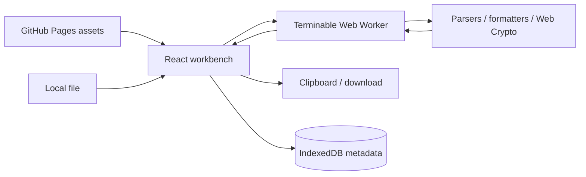

# Developer Toolkit Architecture

## Product and FE design

Audience: developers repeatedly transforming snippets and payloads. First screen: actual editor. Desktop has a fixed discovery rail and aligned input/output panes; mobile uses a dismissible drawer and stacked panes. Compact Space Grotesk/IBM Plex Mono typography, neutral surfaces, teal commands, Lucide icons/tooltips, readable contrast, and reduced-motion support are bundled locally.

## HLD

There is no HTTP backend or server database. The browser engine provides local backend responsibilities: validation, transformation, error normalization, bounds, and output generation. Pages cannot execute Node server processes. No authentication, API credentials, cloud inference, or remote content resolution is needed.

## LLD

| Module | Ownership |
| --- | --- |
| `src/main.tsx` | StrictMode entry point and fonts |
| `src/Shell.tsx` | Search/categories, drawer, favorites, history dialog |
| `src/Workbench.tsx` | Session inputs/options, import/export/copy, worker lifecycle, status/error |
| `src/tools.ts` | Typed catalog, fields/defaults/samples, transformations/limits |
| `src/worker.ts` | Async dispatch and normalized errors |
| `src/storage.ts` | Versioned metadata transactions |

Tool selection is a hash ID. A keyed workbench resets sensitive state on tool changes. HTML/Markdown outputs remain inert text. Code and SQL are formatted, never executed. The palette/color utilities return textual results, not remote media. Favorites update only after persistence completes.

## BE contract

`execute(id, input, options, secondary): Promise<string>`. Worker request: `{id,input,options,secondary}`. Reply: `{output}` or `{error}`. One worker per editor; completion/error/unmount terminates it and clears its timer. Timeout: 15 seconds. Limits: 2M input/5M output characters.

JSON uses the standard parser; YAML has alias bounds; CSV uses PapaParse with formula-safe export; Schema uses local AJV draft-07; formatting uses Prettier/sql-formatter; diff/Markdown use established libraries. Web Crypto handles UUID/random/hash/HMAC. BigInt handles exact base conversion. No inputs or secrets are stored.

## DB design

Database: `local-tools-Developer Toolbox`, version 1. This stable internal name is retained for compatibility with existing browser data; it does not follow the visible page title.

| Store | Key | Value | Retention |
| --- | --- | --- | --- |
| preferences | `favorites` | `string[]` tool IDs | Browser-managed |
| history | UUID `id` | `{id,tool,name,time}` | Last 50 successful jobs |

History pruning/insertion share a read/write transaction. No input/output/file names/keys/passwords are persisted. Storage errors are surfaced. Future changes require a versioned migration. Database names prevent app collisions on a Pages origin, not malicious same-origin tenant access.

## Verification and tradeoffs

All samples run in unit tests and real browser workers. Known vectors/boundaries cover Unicode, precision, schema failures, parser errors, generator/input limits, and contrast. Desktop/mobile tests cover accessibility, overflow, persistence, downloads, and no external requests. This is not cross-browser certification or a security audit. Large parser bundles/worker cold starts are an initial-load cost. Bounds/timeouts reduce, not eliminate, hostile-input memory risks.